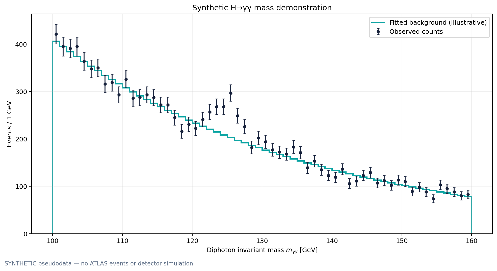
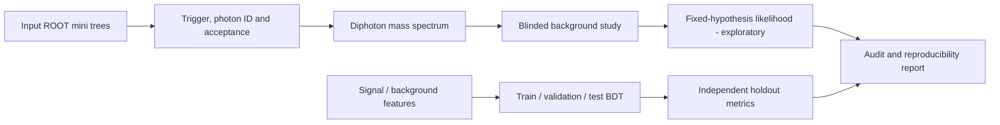

<div align="center">

# ✦ Higgs Diphoton Analysis
### Reproducible H → γγ research with ATLAS-style open data, ROOT/TMVA and transparent statistical inference

**High-energy physics · Diphoton invariant mass · BDT classification · Poisson likelihood · Open-data reproducibility**

[](https://github.com/BurhanKARADUMAN/Higgs-Diphoton-Analysis/actions/workflows/higgs-review-ci.yml)


*A modern research portfolio for understanding the diphoton mass spectrum while distinguishing previous ROOT results, reproducible educational demonstrations and analyses that still need full validation.*

</div>

> [!IMPORTANT]
> **Evidence policy:** The ROOT/TMVA macros and [`analysis_results.txt`](analysis_results.txt) are **historical project artifacts** and remain unchanged. The new Python examples are **synthetic pseudodata**, NOT ATLAS events. The original ROOT input datasets, full luminosity / cross-section normalization details and a calibrated statistical model are **not stored in this repository**. This project does not establish a new Higgs discovery or official ATLAS significance.

## Research snapshot

| Recorded ROOT/TMVA output | Historical value | Interpretation |
|---|---:|---|
| BDT classifier ROC AUC | **0.703** | Logged classifier discrimination estimate; not a signal significance |
| Selected BDT threshold | **0.6764** | Optimized on the studied dataset; requires independent validation |
| Fitted diphoton peak center | **125.54 GeV** | Fit center from historical run, not a new Higgs mass measurement |
| Fitted Gaussian width | **0.93 GeV** | Shape width, **not** the uncertainty on the peak center |
| Historical approximate S/√B | **3.49** | Optimization diagnostic, **not** a calibrated local/global Z |

Source: [`analysis_results.txt`](analysis_results.txt). Detailed discussion in [`docs/SCIENTIFIC_AUDIT.md`](docs/SCIENTIFIC_AUDIT.md).

## At a glance



<sub>**Synthetic pseudodata only.** Deterministic falling background plus an injected 125 GeV Gaussian demonstration. No real collision events appear in the image.</sub>

### What makes this repository useful?

- **Preserves the original analysis** — the C++ ROOT macros, TMVA weights, archived run log and compiled report remain in place.
- **Reproducible independent Python layer** — massless diphoton kinematics, an explicitly simplified Poisson likelihood, fixed-hypothesis modeling and clear source labels.
- **Blinding-aware ROOT input** — optional `uproot` reader for locally supplied ATLAS-style `mini` TTrees; defaults to hiding the 120–130 GeV interval for real data outputs.
- **BDT training hygiene** — optional scikit-learn holdout-validation tool, with separate train/validation/test splits and a threshold selected *without accessing the test labels*.
- **Scientific audit** — documents the distinction between BDT AUC, fitted signal strength, S/√B and calibrated discovery significance.
- **Engineering quality** — automated tests, GitHub Actions, reproducible CLI entry points, labeled demonstration outputs and open research tasks.

## Physics: two photons, one invariant mass

For massless photons expressed using transverse momenta, pseudorapidities and azimuthal angles:

\[
m_{\gamma\gamma}^{2}=2p_{T,1}p_{T,2}\big[\cosh(\eta_1-\eta_2)-\cos(\phi_1-\phi_2)\big].
\]

The new implementation is in [`higgs_review/kinematics.py`](higgs_review/kinematics.py). **Units must be explicit.** The original ATLAS-style mini trees generally store photon momentum in MeV; the Python reader converts to GeV when `--units MeV` is selected.

## Pipeline



## Quick start — no CERN datasets needed

The default demo can run with a standard Python installation. It **does not download or imply access to collision data**.

```bash
python -m venv .venv
# Windows PowerShell: .\.venv\Scripts\Activate.ps1
# WSL / Linux: source .venv/bin/activate
python -m pip install -e '.[test]'
python -m pytest -q
higgs-review --mode demo --output examples/generated
```

Expected outputs: `mass_spectrum.png`, `mass_histogram.csv`, `analysis_metadata.json`. The simulated peak and any calculated local significance **belong only to the pseudodata**.

## Analyze user-supplied ROOT data (opt-in)

Install the optional ROOT file reader and provide your own local files:

```bash
python -m pip install -e '.[root]'
higgs-review --mode root --input /path/to/data_A.GamGam.root /path/to/data_B.GamGam.root \
  --tree mini --units MeV --output results/root_blinded
```

This defaults to **blinding 120–130 GeV** and exports no signal-window counts. If an unblinded diagnostic is justified by an analysis protocol fixed in advance, rerun with `--unblind`. The implementation is a **simplified exercise**, not the official ATLAS event selection / luminosity normalization / statistical model. Verify trigger, TightID, isolation, mass selection and data release before using any result in research.

### BDT checks — independent held-out evaluation

On an independently prepared and labeled **feature CSV** (signal Monte Carlo vs suitable background, with documented provenance):

```bash
python -m pip install -e '.[ml]'
higgs-bdt-check --csv /path/to/labeled_photon_features.csv --out results/bdt_holdout.json
```

Use columns `aeta1,aeta2,adeta,adphi,costh,iso1,iso2,label`. The default classifier explicitly rejects `m_gg`, `pt1_norm`, `pt2_norm` and other direct mass proxies. This **does not automatically guarantee mass decorrelation** and does not address negative MC weights or cross-section scaling; see the audit.

## Historical project files — preserved

| Archive | Purpose / caution |
|---|---|
| [`higgs_diphoton_analysis.C`](higgs_diphoton_analysis.C) | Main integrated C++ macro; historical training and threshold optimization need validation |
| [`higgs_diphoton_analysis_v2.C`](higgs_diphoton_analysis_v2.C) | Historical v2 macro; retained verbatim |
| [`analysis_results.txt`](analysis_results.txt) | Original ROOT/TMVA output; source for the numerical snapshot |
| [`dataset/weights/`](dataset/weights/) | Historical TMVA weights; feature order and file provenance matter |
| [`draw_pvalue_master.C`](draw_pvalue_master.C) | Historical local p-value approximation, **not** calibrated look-elsewhere-corrected discovery |
| [`higgs_diphoton_report_compiled (2).pdf`](higgs_diphoton_report_compiled%20%282%29.pdf) | Historical compiled report |

The repository intentionally keeps these artifacts intact rather than silently rewriting the original research record.

## Repository map

```text
README.md                      This English research overview
higgs_review/                  New reproducible Python educational analysis
  kinematics.py                Massless two-photon invariant mass and acceptance
  statistics.py                Simplified binned Poisson likelihood
  root_io.py                   Opt-in ROOT input with default blinding
  bdt_validation.py            Separate train / validation / holdout evaluation
  simulation.py                Synthetic pseudodata (NOT ATLAS)
  cli.py                       Command-line workflows
examples/demo/                 Regenerable synthetic plots + labeled metadata
tests/                         Automated scientific and software checks
docs/                          Source audit, validation plan and provenance
.github/workflows/             Python CI
*.C, dataset/weights/, *.pdf   Original historical ROOT/TMVA assets — untouched
```

## Validation roadmap

- [x] Audit original C++ and TMVA logs without rewriting historical results
- [x] Implement and test reproducible Python mass calculations and toy likelihoods
- [x] Add default-blinded ROOT input and reproducible pseudodata plots
- [x] Add holdout BDT validation and basic safeguards against obvious mass proxies
- [ ] Obtain and hash the exact original ROOT datasets and record luminosity / cross-section weighting
- [ ] Verify feature transformations and weight files across **each** historical macro
- [ ] Reproduce full ATLAS-style cut flow and test signal / background templates on held-out MC
- [ ] Evaluate BDT mass sculpting, negative MC weights and systematic uncertainties
- [ ] Pre-register mass/threshold choices and perform calibrated profile-likelihood and trials studies
- [ ] Reproduce reference ATLAS Open Data benchmark results with an auditable configuration

## Documentation and sources

- [Scientific audit of original repository](docs/SCIENTIFIC_AUDIT.md)
- [Methodology and fit-statistics limitations](docs/STATISTICS_AND_BLINDING.md)
- [Input data and reproducibility](docs/DATA_PROVENANCE.md)
- [Reproduction guide](docs/REPRODUCIBILITY.md)
- [Research roadmap](docs/ROADMAP.md)
- [Contribution guidelines](CONTRIBUTING.md)
- [ROOT's ATLAS Open Data H→γγ tutorial](https://root.cern.ch/doc/v632/df104__HiggsToTwoPhotons_8py.html)
- [Cowan et al. (2011), asymptotic likelihood methods](https://doi.org/10.1140/epjc/s10052-011-1554-0)

**Researcher:** Burhan Karaduman · Department of Physics, Middle East Technical University (METU), Türkiye.

*Independent educational/research code, not affiliated with or endorsed by the ATLAS Collaboration or CERN. Third-party dataset and historical asset permissions remain their respective owners' responsibility.*
